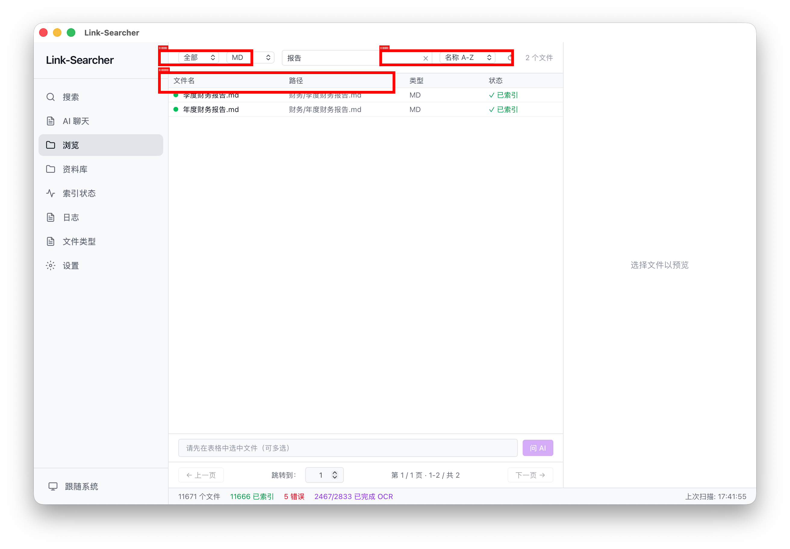

# 第五章：浏览文件

> 文件夹视图（Windows 资源管理器风格）、当前文件夹筛选、右键菜单、批量操作、AI 问答。

---

## 步骤 1：进入浏览页面

点击左侧导航栏的「浏览」图标，进入文件浏览页面。

浏览页就是**文件夹视图**：直接浏览真实文件系统，能看见**未索引文件、空目录**，适合"进到某个案子的文件夹里看东西"。

> **职责边界**：浏览页只做**按目录浏览 + 当前目录内筛选**；按内容做全库关键字检索请用**搜索页**。

## 步骤 2：导航（地址栏与前进后退）

工具栏（从左到右）：

| 控件 | 行为 |
|---|---|
| `←` / `→` | 后退 / 前进（同一会话内的目录历史） |
| `↑` | 上一级；**到资料库根就停住，不能越出资料库** |
| 面包屑 | `资料库 › 案件 › CH 常宏案 › …`，点任意一层直接跳转 |
| 资料库下拉 | 添加了多个资料库时出现，切换浏览哪个库 |
| 筛选当前文件夹 | 只过滤**当前目录已列出**的条目（按名字/路径，本地过滤、不发检索请求） |
| `↻` | 刷新当前目录 |

> 安全边界：桌面端与 Web 端都会拒绝资料库之外的路径（`list_dir_entries` 硬校验），
> 即使前端尝试跳转也只会得到「路径不在已添加的资料库范围内」。

## 步骤 3：文件列表（详细信息视图）

列：**名称、修改日期、最后索引时间、类型、大小、状态、质量**。

- 点任意列头排序，再点一次切换升/降；**目录永远排在文件前面**
- 「最后索引时间」= 该文件正文最后一次提取入库的时间（重新提取 / OCR 后会刷新）；未索引显示 `—`
- 状态含义：

| 标识 | 含义 |
|---|---|
| `✓ 已索引` | 正文已提取并进入检索索引 |
| `◐ 索引中` | 已提取文本、正在写检索索引（或排队中） |
| `✗ 失败` | 索引失败，悬停可看错误原因（右键「查看索引日志」看详情） |
| `○ 待处理` | 已登记、等待扫描/提取 |
| `🗑 已删除` | 文件还在磁盘上但库记录被标删（遗留状态），右键可**恢复** |
| `不支持` | 该扩展名不在可提取格式内（仍可打开/定位） |

- 质量列显示内容质量分（0–100%），未评估显示 `—`

## 步骤 4：选择、打开与预览

| 操作 | 行为 |
|---|---|
| 单击 | 选中该行；文件会同时在右侧预览面板打开 |
| 双击目录 | 进入该目录 |
| 双击文件 | 用系统默认应用打开（**未索引的文件也能打开**） |
| `↑` / `↓` | 在当前列表移动选中项 |
| `Enter` | 进入目录 / 打开文件 |
| `Backspace` | 上一级 |
| `Alt` + `←` / `→` | 后退 / 前进 |
| `F5` | 刷新当前目录 |
| `Ctrl` + 单击 | 多选（状态栏显示已选数量与合计大小） |
| `Ctrl` + `A` | 全选当前目录可见项 |
| `Esc` | 清除选择 |

> 目录项不会触发预览（预览面板只显示文件）。未索引/索引中的文件走"直接读磁盘"预览，
> 所以新放进资料库的文本文件不用等索引也能先看内容。

## 步骤 5：右键菜单

在文件或目录上右键：

| 菜单项 | 说明 |
|---|---|
| 打开 | 目录 = 进入；文件 = 系统默认应用 |
| 在文件夹中显示 | 在 Finder / 资源管理器中定位（未索引文件也可以） |
| 复制路径 | 复制绝对路径 |
| 纯文本 (.txt) / 带标签 (.md) | 导出正文；「带标签」只对**音频**出现（`[00:12:34 · 说话人1]`） |
| 重新索引 | 清掉缓存正文 → 重新提取（必要时重新 OCR）→ 重建索引；已索引文件会先确认 |
| 恢复 | 仅对 `🗑 已删除` 的遗留记录出现 |
| 查看索引日志 | 打开该文件最近 500 行索引日志 |

多选后右键：菜单会变成 **「批量重新索引 N 个」/「批量恢复 N 个」**（只针对有库记录的文件）。

## 步骤 6：AI 问答（需配置 LLM）

选中一个或多个**已索引**文件后，列表下方出现「问 AI」输入框：

1. 选中文件（未索引的文件没有正文，不参与）
2. 输入问题，按 Enter
3. AI 会基于选中文件的内容回答

> 适合「对比多份合同」「总结这批材料」等场景；需要先在设置页配置 LLM 模型（见第六章）。

## 步骤 7：在「质量」页批量修复低质量文件

左侧栏 → **质量**，工具栏常驻三个操作：

| 控件 | 说明 |
|---|---|
| **阈值**（仅「仅问题文件」时显示） | `0.50` / `0.80` / `1.00`（= 不限，只排除尚未评分的）。**改完立即重查**，无需再点刷新 |
| **批量重新提取这 N 个** | 对当前列出的**全部**文件重新提取（清缓存 → 重新提取 / 重新 OCR → 重建索引），完成后自动刷新列表与分布 |
| **补齐质量评分** | 为还没有质量分的文件补算评分 |

工具栏下方是**质量分布概览**（良好 / 一般 / 低质量 / 未评估），与当前筛选无关，可用来判断整体状况。

> **修"评分中等但正文其实是乱码"的文件**（如 90°/270° 旋转扫描件，分数常落在 0.65~0.79）：把**阈值调到 `1.00`** → 列表按质量升序 → 点「批量重新提取这 N 个」。默认的 0.50 抓不到它们。

## ✅ 本章验证清单

| 验证项 | E2E 覆盖 |
|--------|:--------:|
| ✅ 已进入浏览页面 | ✅ 页面加载 |
| ✅ 已用面包屑/上一级在目录间移动（根处不能越界） | — |
| ✅ 已按当前文件夹筛选 | — |
| ✅ 已用列头排序（含最后索引时间） | — |
| ✅ 已双击打开文件 / 进入目录 | — |
| ✅ 已使用右键菜单（含重新索引/恢复/查看日志） | — |
| ✅ 已尝试多选与批量重新索引 | — |
| ✅ 已了解 AI 问答 | — |
