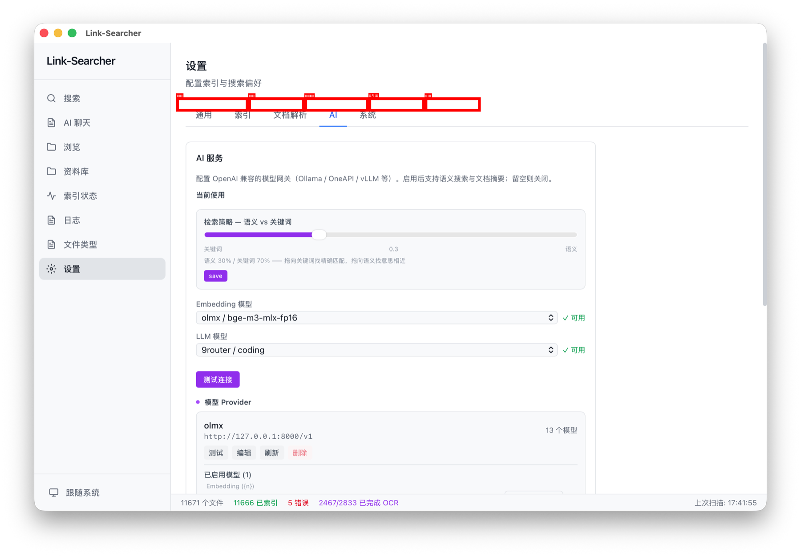
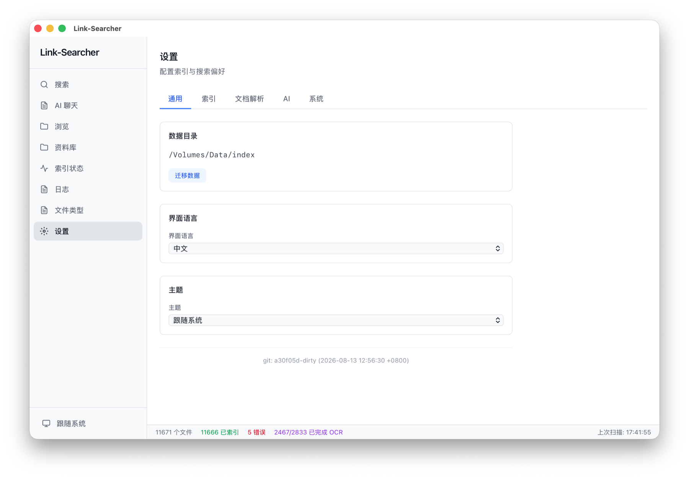
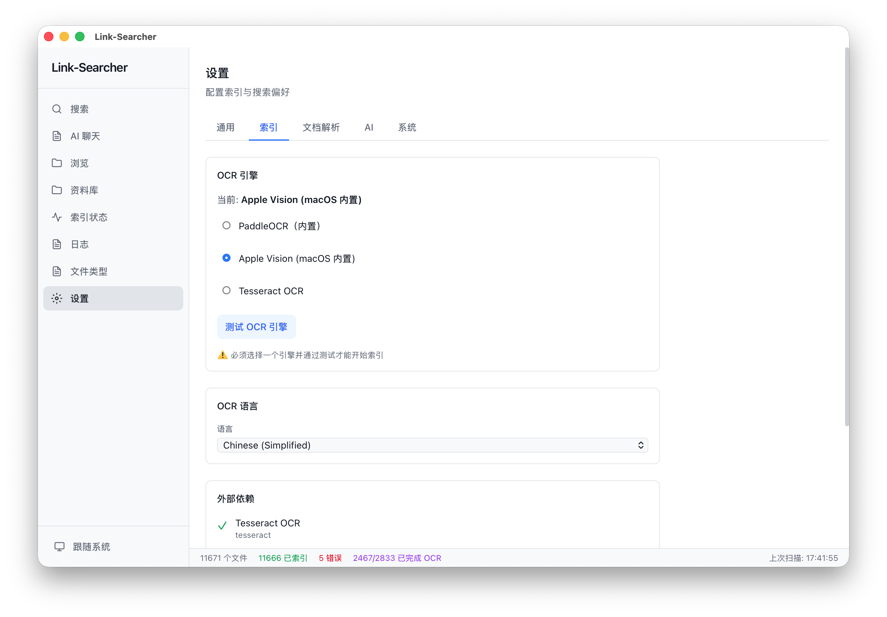
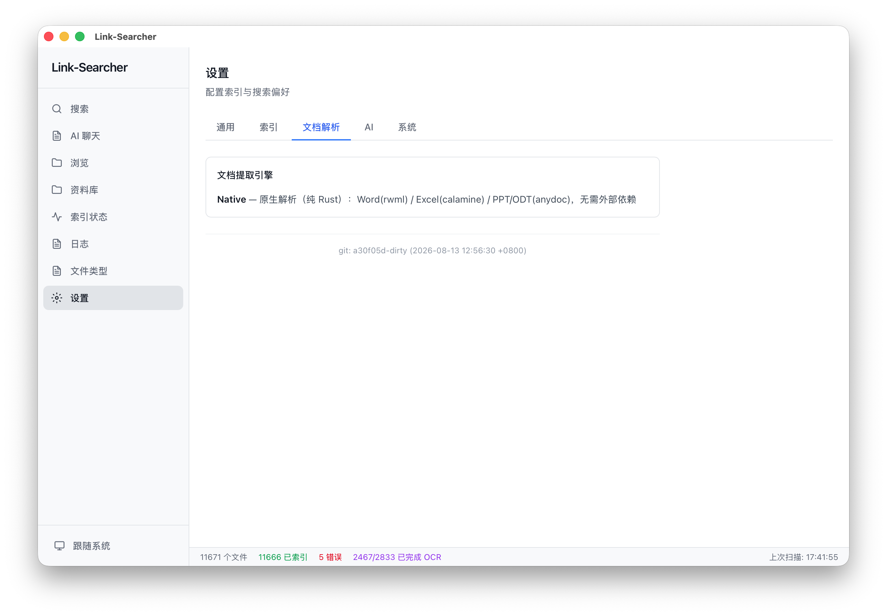
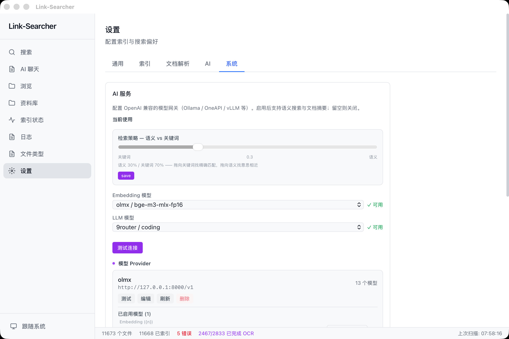
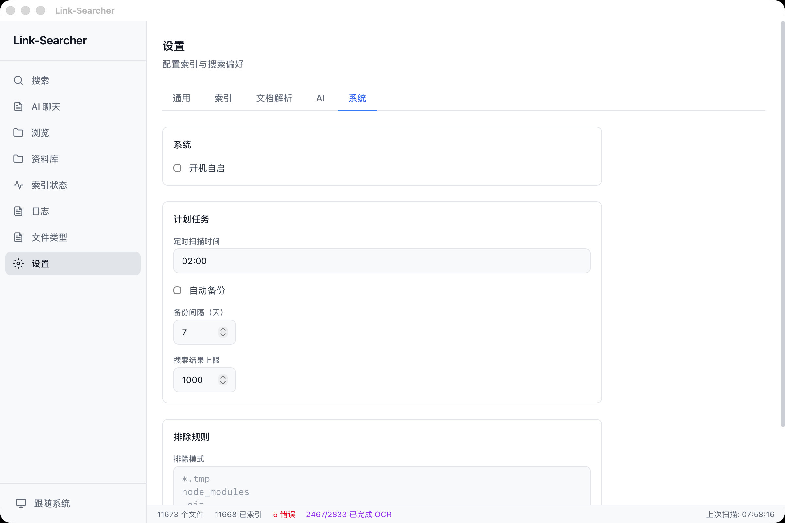

# 第六章：设置详解

> 通用 / 索引 / 依赖中心 / 文档解析 / AI / 备份 / 性能 / 集成 / 系统 标签页逐项说明。

---

设置页分为多个标签页，所有选项**即时自动保存**，无需手动点击保存按钮。页面顶部显示标题「设置」和副标题「配置索引与搜索偏好」。



---

## 通用标签页



### 步骤 1：主题

从「主题」下拉选择框中选择模式：

- **浅色**：白底黑字，适合白天使用
- **深色**：黑底白字，适合夜间使用
- **跟随系统**：自动匹配系统主题设置

> 也可以通过左侧导航栏底部的主题按钮快速切换。按钮文字会随当前主题显示为「浅色」「深色」或「跟随系统」。

### 步骤 2：界面语言

从下拉菜单中选择界面语言：

- 中文
- English
- 日本語
- 한국어

选择后界面语言即时切换，无需重启。

### 步骤 3：数据目录与迁移

- **数据目录**：显示当前索引和数据库的存储路径
- **迁移数据**：点击后选择新目录，自动复制所有数据，然后重启生效

> 迁移前请确保目标目录有足够的磁盘空间。

### 初始化向导

「初始化向导」区块提供「重新运行向导」按钮，点击后重新打开首启向导（功能介绍 → 依赖检测/下载 → 准备就绪），便于引导新用户或补装运行依赖。

---

## 索引标签页



### 步骤 4：选择 OCR 引擎

| 引擎 | 说明 |
|------|------|
| PaddleOCR（默认） | PP-OCRv5 模型：发布版首次启动由「初始化依赖」向导下载（约 20MB，镜像），开发版用仓库内模型 |
| Windows OCR（Windows） | 系统原生；若缺语言包，列表会显示具体缺失并给补装指引 |
| Apple Vision（macOS） | 系统原生，无需安装 |
| Tesseract OCR | 备选引擎，需自行安装 `tesseract` CLI |

> 发布版若未安装模型，引擎列表会显示「未安装」并给出安装指引；也可前往「依赖中心」标签页安装。

### 步骤 5：测试 OCR 引擎

选择引擎后，点击「测试 OCR 引擎」按钮验证是否可用：

- 测试成功：显示 ✓ 绿色标记
- 测试失败：显示 ✗ 红色标记，需要检查安装

> 必须选择一个引擎并通过测试，才能开始索引。

### 步骤 6：设置 OCR 语言

选择 OCR 识别语言：

- `eng` — 英文
- `chi_sim` — 中文简体
- `jpn` — 日文
- `kor` — 韩文

> PaddleOCR 内置支持中英文混排识别，不受此设置影响。

### 自适应并发（内存压力降级，可选）

索引几百页的大扫描件时内存占用会明显上升。开启后程序每 5 秒采样一次**本进程占用**与**系统已用内存**，按你设的阈值自动分四档调节并发，压力解除后再逐级恢复：

| 档位 | 页窗口 | OCR 并发 | 在飞文档 | 默认触发条件 |
|---|---|---|---|---|
| 正常 | 4 | 8 | 不限 | 本进程占物理内存 < 40% 且 系统已用 < 85% |
| 软降级 | 3 | 8 | 6 | 本进程 ≥ 40% 或 系统已用 ≥ 85% |
| 硬降级 | 2 | 6 | 4 | 本进程 ≥ 55% 或 系统已用 ≥ 90% |
| 暂停派发 | 停止派发新页 | 等待 | 等待 | 本进程 ≥ 70% 或 系统已用 ≥ 95% |

> 「本进程」= Link-Searcher 自己的内存占用，按**占物理内存的百分比**衡量（31GB 机器 → 40/55/70% ≈ 12.4/17/21.7GB；16GB 机器 → 6.4/8.8/11.2GB）。用百分比而不是固定 MB，是因为**占用多少才算多**取决于本机容量；另有一路"系统已用"信号兜底其它程序把内存吃光的情况。
>
> **回滞带**：升档要求样本明显优于当前档阈值（默认低 5 个百分点），否则档位会在阈值附近反复升降（实测一轮 59 次），每次都把并发砍半——所以"降快升慢"还额外带一条带宽。
>
> **闸门不会拖死全局**：任何许可等待超过 30 秒都会**强制放行**并记 WARN——2026-10-14 实测过"文档许可被卡住的文档占满 → 整条流水线停摆 25 分钟"，这条兜底就是为此加的。

- **只降并发，不改图像清晰度**：识别质量不受影响（不会为了省内存偷偷降低分辨率）。
- **不丢正文**：「暂停派发」只停止**新**页与新文档，正在跑的页会正常跑完；若某篇文档被中途打断，它会判为失败并在后续扫描时重试，**不会**把残缺内容当成成功写进索引。
- **降快升慢**：压力升高立即降档（可一步到暂停）；恢复需要连续 12 次（约 1 分钟）平静才升一档，避免来回抖动。
- 阈值可在设置页「索引 → 自适应并发（内存压力）」按本机情况调整（默认值已按物理内存百分比给出，一般无需改动）。
- 索引状态页的「并发档位」显示当前档位；日志中每次变化都有 `[LOAD]` 一行，写明本进程占用、系统已用与各闸门的前后值，便于事后解释"为什么这轮变慢了"。
- 排查/演练：环境变量 `LINK_SEARCHER_LOAD_FORCE=soft`（或 `hard` / `paused` / `normal`）可手工压档。

---

## 依赖中心标签页

「依赖中心」集中列出所有可安装的运行依赖（PaddleOCR 模型、BGE 语义模型、重排模型、FunASR 音频模型等），显示每项的安装状态（✓ 已安装 / ✗ 未安装）、说明与体积，并提供「立即安装」按钮和下载进度。本地语义模型为**三选一**：BGE 行内有一个单选下拉框（`bge-small` 512 维 / `bge-base` 768 维 / `bge-large` 1024 维），选好维度后点「立即安装」；安装完成会自动设为当前 embedding 模型并**删除其它维度的模型文件**（切换后需重建语义向量，见索引状态页横幅）。**重排模型**同样是单选下拉框（可选）：`bge-reranker-base`（中英）/ `ms-marco-MiniLM-L-6-v2`（英文/快），安装后自动设为当前重排模型。顶部缺依赖提示条会直接跳转到此页。

---

## 文档解析标签页



文档解析标签页展示各格式的文本提取引擎状态，无需手动配置。

---

## AI 标签页



### 步骤 7：添加 AI Provider

1. 点击「添加 Provider」
2. 填写以下信息：
   - **名称**：给 Provider 起个标识名（如「本地 Ollama」）
   - **Base URL**：OpenAI 兼容网关地址（如 `http://127.0.0.1:11434/v1`）
   - **API Key**：网关密钥（本地服务可留空）
3. 点击「保存」——系统自动拉取模型列表

### 步骤 8：选择当前使用的模型

保存 Provider 后，模型会自动分类：

- **Embedding 模型**：用于语义搜索（如 `bge-m3-mlx-fp16`）
- **LLM 模型**：用于 AI 摘要、问答、聊天（如 `qwen2.5-7b-instruct`）
- **重排（Reranker）模型**：用于对检索结果重新排序（可选）。下拉里既有远程网关模型，也有**内置本地重排模型**（bge-reranker-base 中英 / ms-marco-MiniLM-L6 英文，需先在**依赖中心**安装）

在「当前使用」下拉框中分别选择 Embedding、LLM 和重排（Reranker）模型。不选 = 对应功能停用。内置本地重排走 cross-encoder，CPU 上较慢（每个候选一次前向），建议只在确实需要时启用。

### 步骤 9：管理 Provider

- **测试**：验证 Provider 连通性
- **刷新**：重新拉取模型列表（不影响手动分类）
- **编辑**：修改 Provider 配置
- **删除**：移除 Provider（正在使用的不可删除，需先切换模型）

### 步骤 10：测试连接

点击「测试连接」按钮，分别验证当前 Embedding 和 LLM 模型的连通性：

- ✓ 绿色：可用
- ✗ 红色：不可用，对应功能会自动禁用

---

## 性能标签页

性能标签页用于查看本机硬件信息并自动调优索引速度。

### 步骤 11：查看硬件信息

打开标签页时自动检测并展示：

- **CPU 核心数** — 决定并行工作线程上限
- **磁盘类型** — 按写入吞吐归类为 `NVME` / `SSD` / `HDD`
- **磁盘速度** — 在数据目录写入 32MB 落盘文件、多次取中位数的顺序写吞吐（MB/s）。带 `≈` 的数值为估算值，受系统负载与缓存影响
- **操作系统** — 当前平台标识

### 步骤 12：选择性能档位 / 一键优化

可直接在「当前配置」中选择 **保守 / 均衡 / 激进** 三档，或点击「⚡ 一键优化」由系统按硬件推荐一档。**档位只表达取向，具体数值按本机硬件自动缩放**——同一档位在不同机器上会得到不同参数：

| 参数 | 保守 | 均衡 | 激进 |
|------|:---:|:---:|:---:|
| 并行工作线程 | `clamp(核心数×0.5×磁盘系数, 1, 8)` | `clamp(核心数×1.0×磁盘系数, 2, 16)` | `clamp(核心数×1.5×磁盘系数, 4, 24)` |
| 提交间隔 | 500 | 1000 | 2000 |
| 写入缓冲区 | 100MB | 200MB | 300MB |

> 磁盘系数：NVMe 1.0 / SSD 0.75 / HDD 0.35 / 未知 0.5（机械盘会压低并行度以免寻道抖动）。
> 一键优化推荐规则：≥16 核 + 快速盘 → 激进；≥8 核 + 快速盘 → 均衡；其余（含 HDD、低配机）→ 保守。
> 选择后立即生效并持久化（重启后保持）；索引过程中修改参数，下一批次即生效。
> **写入缓冲区**在空闲时立即重建 writer 生效，扫描进行中则于下次扫描生效（避免丢弃未提交文档）；页面「当前配置」显示的是**运行中实际应用的值**（非仅数据库值）。

### 步骤 12.1：嵌入相关开关

- **嵌入并行度**（`embed_parallelism`）：**内置** BGE 在向量回填时并行的模型副本数（每个约 1GB 内存）。`0` = 自动（≈ CPU 核数一半，最多 4）；仅当嵌入模型为内置时生效。
- **远程嵌入自适应并发**（`embed_adaptive`，默认开）：嵌入模型指向**远程网关**时启用「并发 + 自适应批/并发度」——小批起步，吞吐提升则逐步加档，真正回退时降档、平台期保持、出错自动回退，并按「网关+模型」把最优点记入 `config.json` 的 `embed_plans`；下次从最优点附近起步。关闭后退回固定单并发批次。回填进度日志会附带当前计划（`batch=… 并发=… 峰值=…tok/s`）。

> 该开关对环境变量 `LINK_SEARCHER_EMBED_ADAPTIVE=0` 同样生效（优先级高于设置）。

---

## 集成标签页

把飞书机器人接到本机上。**无需公网**：机器人用飞书的长连接收消息，
再经本机的 Web API（`https://127.0.0.1:8443`）读写索引与 AI 能力 —— 但也因此要求
**应用保持运行**，应用一停机器人就收不到消息。

> 📖 **怎么用、有哪些限制与坑**：见 [第十三章：飞书机器人](13-lark.md)；
> 设计与实测记录见 `docs/LARK_BOT.md`。本章只讲**设置项**。

### 步骤 12.1：前置 —— 绑定飞书应用（这一步不在本应用的配置里）

「用哪个飞书应用」这件事**不归本应用管**：App ID / App Secret 存在 **`lark-cli` 自己的配置**里
（`%USERPROFILE%\.lark-cli\config.json`，其中 App Secret 进系统凭据库）。
本应用只做两件事：**看得见**（自检）与**代跑一条命令**（绑定）。

页面上方的「**飞书接入自检**」会实际去问 `lark-cli` 要状态，并显示：

| 显示项 | 含义 |
|---|---|
| `lark-cli` | 可执行文件路径与版本；`未发现` 时请到「依赖中心」安装（依赖中心的"就绪"**只表示文件在**，不代表已授权） |
| `App ID` | 当前绑定的飞书应用；这就是"看不到 appid"的那个值 |
| `bot 身份` | **机器人收发消息靠它**。`warn`/`fail` 且提示 `verify failed` ＝ 凭据失效 / 应用被删 —— 此时界面"看着已绑定"，机器人也不会动 |
| `user 身份` | 只有"以你的身份调飞书 API"才需要；**缺它不影响机器人** |
| `卡片回调订阅` | 答案卡片上的按钮需要单独订阅 `card.action.trigger`；`blocked` 时按提示订阅 |
| `下一步：…` | 缺哪一步、该做什么（只报**第一个**阻塞项） |

> 自检跑的是 `lark-cli doctor`（**会联网校验**）。为什么不信 `lark-cli auth status`：
> 实测给一个**根本不存在的** App ID，`auth status` 依然报 `bot 身份 ready` —— 它只做本地结构检查。

**绑定**（「绑定飞书应用」区块）：

- **新建应用（浏览器流程）**：会让你在飞书里**新建一个应用**并一次配好机器人能力 / 事件 / 权限
  （`lark-cli config init --new`，阻塞到你在浏览器里完成）。界面会把验证链接列出来供点开。
- **绑定已有应用**：填 App ID / App Secret（`--app-id` + `--app-secret-stdin`）。
  Secret **只经标准输入**交给 lark-cli，不进进程列表、不写本应用的配置、不打日志。
- ⚠️ **已绑定时会警告"会覆盖"**：`lark-cli config init` 是**先写盘再校验**的，凭据填错也会先覆盖。
  本应用在绑定前**快照**配置、判定失败即**自动回滚**（并在输出里说明）。
- 绑定过程中可以**取消**；成功后应用会**重启机器人进程**，让新凭据立刻生效。
- 绑定完成后，仍需按 12.2 打开总开关、按 12.3/12.4 把自己加进白名单 —— **不会自动启用**（外发内容必须显式开启）。

> 两条命令行的等价物（不想用界面时）：
> ```bash
> lark-cli config init --new                                   # 新建应用
> lark-cli config init --app-id cli_xxx --app-secret-stdin     # 绑定已有应用
> lark-cli auth login                                          # 仅当需要 user 身份
> ```

### 步骤 12.2：启用机器人

- **启用飞书机器人**（`enabled`）：总开关。**默认关闭**；关闭时下面的运行态会显示「已停止」。
- **仅允许私聊**（`require_p2p`）：开启后只在**私聊**里应答，群里 @ 它一律不理（推荐保持开启）。
- **运行态**：显示进程是否在跑、已绑定几个会话、是否处于配对中（该信息来自服务端，不靠界面计时）。

> **改完即时生效**：保存后应用会自动**重启机器人进程**（它只在启动时读一次策略）。
> 机器人进程由应用托管，**不要**手动去起 / 杀它。

### 步骤 12.3：两个名单（方向相反，别混）

- **允许的用户**（`allowed_users`）：能私聊机器人的飞书用户 `open_id`，一行一个。
  **留空＝谁都不允许**（连你自己也不行）。
- **允许外发的目录**（`export_allow_dirs`）：**预留项，当前版本暂不生效** —— 它约束的是"把本地内容
  写成飞书文档 / 表格"这个出口，而这个出口**还没实现**（机器人现阶段只会**读**本地内容来回答，
  不会把内容写出去）。值会被保存下来，等该能力落地后按"允许的本地目录"生效；**留空＝不限制**。

> 两个名单**空的含义正好相反**，界面上各自的说明文字不同，别"顺手统一"。

### 步骤 12.4：配对（第一次使用的最快路径）

不知道自己的 `open_id`？用配对：

1. 先确认**已启用机器人**（否则没有进程去收那条私聊），点「开始配对」（默认 5 分钟）；
2. 用飞书**私聊**机器人**任意发一条消息**；
3. 该消息**不会得到回答**（它只用来登记身份，属安全边界）；稍后回到本页面，
   「允许的用户」里会出现你的 `open_id`，配对自动关闭。

> 配对期间请勿把机器人分享给别人：**配对期内任何私聊它的人**都会被写进白名单。
> 过期 / 取消后入口立即失效（判定在服务端，界面倒计时只是显示）。

> 本页会随配置变化**自动刷新**（手改 `config.json`、他处改动、配对完成都会推送到界面）。

### 步骤 12.5：在飞书里用命令（搜索 / 多会话）

启用机器人后，在飞书**私聊**机器人即可使用以下命令（**全英文、以 `/` 开头**）：

| 命令 | 作用 |
|------|------|
| `/help` | 显示命令帮助（单独发一个 `/` 也一样） |
| `/current` | 查看**当前会话**（名字 / 消息数；页眉醒目显示名字） |
| `/history` | **召回当前会话的全部内容**（分页卡片；别名 `/recall`） |
| `/new` | 新建一条会话并切换过去（对话按**会话**分组，各自独立多轮） |
| `/sessions` | 会话列表卡片，点按钮或**回复数字**即可切换 |
| `/switch 3` | 切到第 3 个会话（也可用标题前缀，如 `/switch 合同`） |
| `/rename 新名字` | 给**当前会话**改个名字（立刻生效，桌面/Web 端同步可见） |
| `/stop` | **停止正在生成的回答**（检索阶段也会被中断；生成中卡片上也有「停止」按钮） |
| `/delete 3` | 删除第 3 个会话的**飞书映射**（先弹确认，防误删；内容仍留在本地） |
| `/find 关键词` | 搜索本地库，返回命中列表（每页 5 条；可加页码 `/find 合同 2`） |

几个要点：

- **直接提问**（不带 `/`）就是 AI 问答：默认在当前活动会话里多轮进行；
- **自动新话题切换**：换一个明显不相关的话题提问时，AI 会自动**另开一条新会话**并提示
  （旧会话保留，可在 `/sessions` 里切回）—— 判定很保守，拿不准就不切，追问/细化不会触发；
- **随时看得到当前会话名**：回答卡片（含生成中的流式卡片）**页眉（蓝色）以会话名开头**
  （`合同审查 · 回答`）；也可随时发 `/current` 查看。名字默认是**首问的前 20 字**，
  不满意就 `/rename` 改成好认的（上限 30 字）；
- **想回顾聊过什么**：发 `/history` 把当前会话的完整内容召回成卡片；
- **想停下正在生成的长回答**：发 `/stop`，或直接点卡片上的「停止」按钮 —— 已生成的部分会保留在卡片里；
- 图中列表发数字（如 `3`）可选择对应项，**与按钮等价**（零配置，不依赖任何后台设置）；
- **搜索卡**：`/find` 结果卡自带「上一页 / 下一页」（**原地更新同一张卡**，不刷屏；每页 5 条）
  与「✦ 语义」开关（配了 Embedding 才出现；点击用同一关键词按"意思"重搜）；
- **把原文件发到飞书**：`/find` 结果卡里每条命中带「发送 N」按钮 —— 点它会把对应的原文件发到
  当前私聊（图片直接预览；`.opus` 或可转码的音频发成**语音气泡**；其它文件按附件发）。
  受飞书硬限制：**图片 ≤10MB、文件/语音 ≤30MB**；超过 30MB 会提示改用 WebUI 查看。
  首次使用若报权限错误，需在开发者后台补 `im:resource` 权限并重新发布；
- ⚠️ **飞书客户端本身不支持"输入 `/` 弹命令列表"**（官方 FAQ 明确机器人不支持斜杠命令）。
  最接近的是**机器人自定义菜单**（常驻在输入框旁，仅单聊）：如需开启，需在
  [飞书开发者后台](https://open.feishu.cn/app)该应用的「机器人能力 → 自定义菜单」里
  配置（建议把菜单项配成**推送事件**、`event_key` 直接填对应命令如 `/new`；发布应用版本
  后约 5 分钟生效）—— 应用侧已支持接收菜单点击，**不配置也不影响上面所有命令**。

> 📖 **完整用法、限制与故障排查**（含出站文件、翻页/语义、WebUI 深链、注意事项）
> 见 [第十三章：飞书机器人](13-lark.md)。

### 步骤 12.6：WebUI 链接地址（可选）

机器人的「打开详情」按钮会给一个 WebUI 链接。默认自动选择地址：
**Tailscale 地址（100.64/10，若本机装了）> 局域网 IP**，并把另一个可用地址附成
"打不开就换这个"（多网卡机器不会去猜"手机是否在同一网络"——飞书不提供客户端 IP）。

想固定成自己的域名 / 反向代理，可在 `config.json` 里手配（留空 = 自动）：

```json
{ "webui_base_url": "https://link.example.com" }
```

改完**即时生效**（配置每次现读，无需重启）。自签名证书仍会先提示「不安全」，
点「继续访问」信任一次即可；换网络后若地址不在证书 SAN 里，同样会多一次该提示。

---

## 系统标签页



### 步骤 13：开机自启

开启后，Link-Searcher 随系统自动启动（macOS 使用 LaunchAgent，Windows 使用启动项）。

### 步骤 14：计划任务

- **定时扫描时间**：设置每日自动扫描的时间点（默认 `02:00`）。到点后**在一次全量比对里**核对所有目录
  （未变更的文件只比 mtime/大小，不会重新提取内容）。**清空此框即关闭定时扫描**（空值或非法时间一律视为关闭）。
- **自动备份**：开启后按下方间隔自动备份索引数据到备份目录（**默认关闭**，需手动勾选）。
- **备份间隔（天）**：备份周期，如 7 天
- **搜索结果上限**：单次搜索返回的最大结果数（默认 1000）。数值越大，搜索结果页可能越长。

> 计划任务由**应用运行期间**的后台维护线程执行（每 60 秒检查一次）：应用没开着的时段不会补跑，
> 但"今天是否已跑过"是按日期记录的 —— 到了时间点应用才启动，当天仍会跑一次。
> 该线程同时负责：文件监控事件队列溢出（大目录一次性同步时）后的自动补扫。

### 步骤 15：排除模式

添加全局 glob 排除规则，适用于所有资料库。例如：

- `*.log` — 排除所有日志文件
- `node_modules/*` — 排除 node_modules
- `build/*` — 排除构建产物

> 这里的排除规则对所有资料库生效，与各目录的独立排除规则叠加。

### 步骤 16：Web API

- **启用 Web API**：**默认开启**，启动即监听（仅显式关闭才会停）；开关 / 端口 / 绑定地址修改后**需重启应用**生效
- **访问地址**：页面会显示本机地址与**局域网远程地址**（含「复制」按钮），其它机器浏览器打开后输入 Bearer Token 即可使用（自签名证书需在浏览器信任一次）。**前端随应用内嵌**（release 安装包里不需要任何额外文件，也不会依赖启动目录）
- **开发模式**：代理到 Vite dev server（需先运行 `npm run dev`）
- **端口**：Web API 监听端口（默认 8443）
- **会话空闲超时（秒）**：默认 600；超过后会话自动释放，其它设备方可登录（**无需重启，立即生效**）
- **Bearer Token**：访问凭据，可点击「重新生成」——token 持久化在 `config.json` 的 `web_api_token` 字段（启动时读取，也支持环境变量 `LS_WEB_API_TOKEN` 注入），设置页与 Web 端均可修改，修改会同步回写配置文件
- **绑定地址**：局域网（`0.0.0.0`）或仅本机（`127.0.0.1`）。默认 `0.0.0.0`（方便手机/Tailscale 远程访问），**风险也随之而来**：Token 是唯一门槛，证书是自签的（同网段若被中间人劫持，流量可被解密）；不需要远程访问时请改为「仅本机」——设置页在选到非回环绑定时会显示一条醒目提示，绑定非回环时启动日志也会打一条 WARN
- **在线状态**：**多端可同时使用**（手机浏览器 / 电脑浏览器 / 飞书机器人并存；原"单用户 IP 排他"已废弃）。页面显示最近活跃来源 IP，可「清除记录」（只清展示记录，不阻断访问）；**Token 是唯一门槛，请勿把端口暴露到公网**
- **依赖中心（Web 端同样可用）**：依赖面板 / 首启向导在浏览器里也能**查看每个依赖是否就绪并直接安装/取消**，进度条与完成刷新经 `/api/events`（SSE 事件桥）推送

## ✅ 本章验证清单

| 验证项 | E2E 覆盖 |
|--------|:--------:|
| ✅ 已查看通用标签页（主题、语言） | ✅ 页面加载 + 主题切换 |
| ✅ 已查看索引标签页（OCR 引擎、语言） | ✅ OCR 设置项存在 |
| ✅ 已查看依赖中心标签页 | — |
| ✅ 已查看文档解析标签页 | — |
| ✅ 已了解如何添加 AI Provider | — |
| ✅ 已了解 Embedding / LLM / 重排模型的区别 | — |
| ✅ 已查看性能标签页并选择档位 / 一键优化 | — |
| ✅ 已查看集成标签页（飞书机器人 / 白名单 / 配对） | — |
| ✅ 已查看系统标签页 | ✅ 页面加载 |
| ✅ 已确认所有设置项自动保存 | ✅ 设置更新 IPC |
